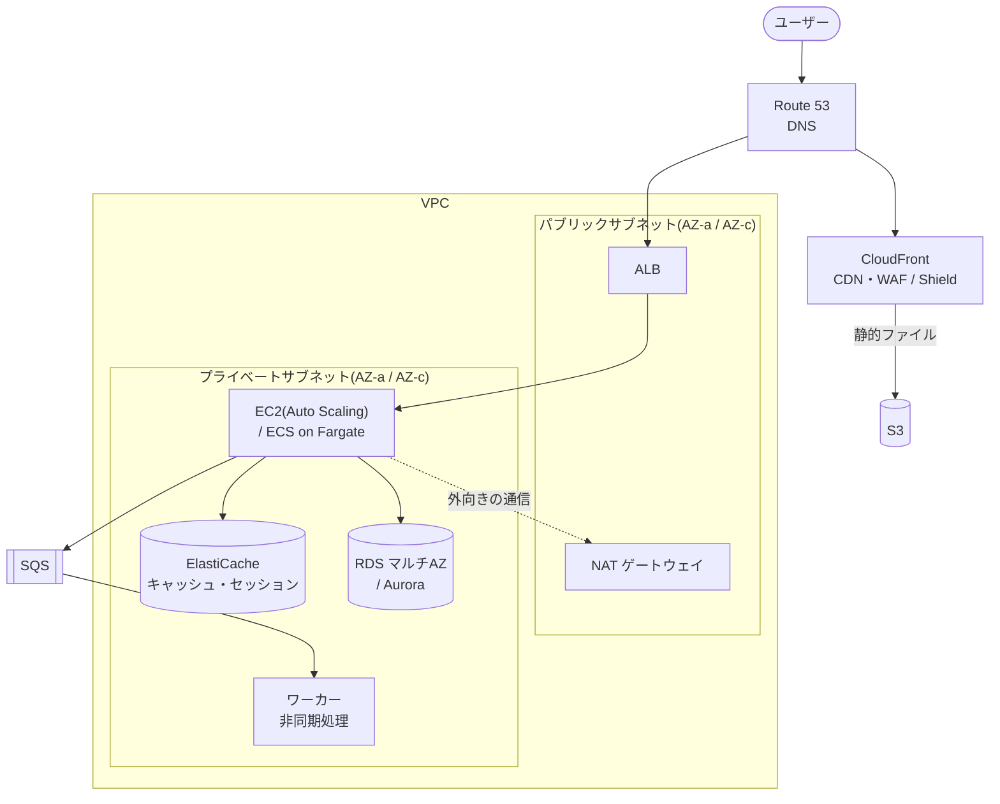

**AWS のサービスを組み合わせて、安全・止まらない・速い・安いシステムを設計できるか** を問う資格。AWS 認定の中で一番受験者が多く、クラウドを仕事で使う人の「最初の目標」になりやすい。

このノート群の目標は **SAA に合格できるだけの知識を、出題パターンと一緒に覚えること**。各ノートの最後の「確認ポイント」を全部説明できれば合格ラインに届く。

## 試験の概要
| 項目 | 内容 |
| --- | --- |
| 試験コード | SAA-C03(改訂されることがあるので、受験前に公式の試験ガイドで確認) |
| 時間 / 問題数 | 130分 / 65問(うち15問は採点されない) |
| 形式 | 単一選択・複数選択 |
| 合格点 | 1000点中 **720点** |
| 受験料 | 150 USD(日本では税込 16,500円) |
| 受験方法 | テストセンター または 自宅からオンライン |
| 有効期間 | 3年 |

### 出題分野
| 分野 | 比率 | 主に対応するノート |
| --- | --- | --- |
| セキュアなアーキテクチャの設計 | 30% | 02、03 |
| 弾力性に優れたアーキテクチャの設計 | 26% | 04、07、08 |
| 高性能なアーキテクチャの設計 | 24% | 03、04、05、06 |
| コストを最適化したアーキテクチャの設計 | 20% | 09 |

## 学ぶ順番
| # | ノート | 内容 |
| --- | --- | --- |
| 01 | [[SAA_01_AWSの基本(リージョン・AZ・責任共有モデル・Well-Architected)]] | リージョン・AZ、責任共有モデル、6本の柱、問題文の読み方 |
| 02 | [[SAA_02_IAMとセキュリティ(IAM・KMS・Organizations・WAF)]] | IAM ロール、ポリシー評価、SCP、暗号化、WAF・GuardDuty など |
| 03 | [[SAA_03_ネットワーク(VPC・ELB・Route 53・CloudFront)]] | VPC の構成、SG と NACL、エンドポイント、VPN・DX、ELB、Route 53 |
| 04 | [[SAA_04_コンピューティング(EC2・Auto Scaling・Lambda・コンテナ)]] | EC2 の購入オプション、Auto Scaling、Lambda、Fargate |
| 05 | [[SAA_05_ストレージ(S3・EBS・EFS・FSx)]] | S3 のストレージクラスと機能、EBS、EFS・FSx、データ移行 |
| 06 | [[SAA_06_データベース(RDS・Aurora・DynamoDB・ElastiCache)]] | マルチAZ とリードレプリカ、Aurora、DynamoDB、キャッシュ |
| 07 | [[SAA_07_疎結合と分析(SQS・SNS・EventBridge・Kinesis・Athena)]] | SQS・SNS・EventBridge の使い分け、Kinesis、分析サービス |
| 08 | [[SAA_08_高可用性・DR・移行(バックアップ・DR戦略・監視)]] | 定番構成、RPO/RTO、DR 戦略4つ、移行、CloudWatch・CloudTrail・Config |
| 09 | [[SAA_09_コスト最適化(料金モデル・コスト管理)]] | 料金のしくみ、分野ごとの削減策、コスト管理ツール |
| 10 | [[SAA_10_頻出パターンと練習問題]] | キーワード → 答えの早見表、練習問題15問、当日のコツ |

### 補足ノート
| ノート | 内容 |
| --- | --- |
| [[SAA_補足_Systems Manager(Session Manager・Parameter Store・Patch Manager)]] | SSH なしでサーバーに入る Session Manager、Parameter Store と Secrets Manager の違い、パッチ自動化 |
| [[SAA_補足_監視と監査(CloudTrail・CloudWatch・Config)]] | CloudTrail(操作の記録)・CloudWatch(監視)・Config(設定の記録)の違いと使い分け |
| [[SAA_補足_ログのまとめ(種類・保存先・分析)]] | VPC フローログ・ELB・CloudFront・S3 などのログの種類、保存先、Athena などでの分析 |

## まず一言で
> **SAA は「動くかどうか」ではなく「条件に一番合うのはどれか」を選ぶ試験。**
> 問題文の最後にある「最もコスト効率が高い」「運用負荷が最も少ない」「最小限の変更で」を見落とさないこと。

## 全体像(定番の Web 3層構成)

```
ユーザー
  │
Route 53(DNS) ─▶ CloudFront(CDN) ─▶ S3(静的ファイル)
  │                 └ WAF / Shield
  ▼
┌──────────── VPC ────────────────────────────┐
│ パブリックサブネット(AZ-a / AZ-c)         │
│   ALB、NAT ゲートウェイ                        │
│ プライベートサブネット(AZ-a / AZ-c)       │
│   EC2(Auto Scaling)/ ECS on Fargate        │
│      └─▶ SQS ─▶ ワーカー(非同期処理)        │
│   ElastiCache(キャッシュ・セッション)         │
│   RDS マルチAZ / Aurora                        │
└─────────────────────────────────────────────┘
監視: CloudWatch / 監査: CloudTrail / 設定チェック: Config / 権限: IAM ロール
```



監視・監査の3つの違いは [[SAA_補足_監視と監査(CloudTrail・CloudWatch・Config)]] にまとめている。
この図の**どこを、何に置き換えると、どの条件が良くなるか**を問うのが SAA の問題のほとんど。

## 勉強の進め方(目安 1〜2か月)
1. **このノートを01から順に読む**(1日1ノート × 10日)
2. **手を動かす**:無料利用枠で VPC(パブリック/プライベート)を作り、EC2 を立てて ALB をつなぎ、S3 にファイルを置く。1回やるだけで 03・04・05 の理解が大きく変わる
3. **問題演習を中心にする**:AWS Skill Builder の公式練習問題、Udemy などの模擬試験を繰り返す
4. **間違えた問題は、全部の選択肢について「なぜ違うか」を言えるようにする**。ここで覚えたことを各ノートに書き足す
5. 模擬試験で**安定して 80% 以上**になったら受験する

## 関連ノート
- [[IPアドレス・サブネット]]
- [[ルーティング・NAT]]
- [[DNS]]
- [[認証]]
- [[SQL]]
