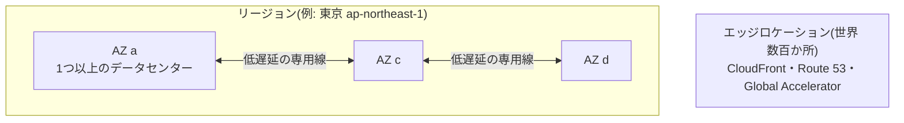
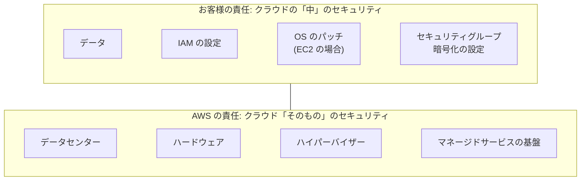

← [[AWS SAA]] / 次 → [[SAA_02_IAMとセキュリティ(IAM・KMS・Organizations・WAF)]]

## AWS の物理的な構造
```
リージョン(例: 東京 ap-northeast-1)   ← 地理的に離れた場所。データは勝手に外へ出ない
 ├─ AZ(アベイラビリティーゾーン) a   ← 1つ以上のデータセンター。電源・ネットワークが独立
 ├─ AZ c
 └─ AZ d
     AZ 同士は低遅延の専用線でつながる

エッジロケーション(世界 数百か所)    ← CloudFront・Route 53・Global Accelerator が使う
```



| 単位 | 障害への強さ | 試験での使いどころ |
| --- | --- | --- |
| **複数 AZ(マルチAZ)** | データセンター1つが落ちても動く | 「高可用性」と言われたらまずこれ |
| **複数リージョン** | 地域全体の災害でも動く | 「災害対策(DR)」「世界中のユーザーに低遅延」 |
| **エッジ** | — | 「静的コンテンツを世界に速く配信」 |

### リージョンの選び方(4つの観点)
1. **法令・データの所在**(日本国外にデータを置けない など)
2. **ユーザーとの距離**(レイテンシー)
3. **使いたいサービスがあるか**(新サービスはリージョンによって未提供)
4. **料金**(リージョンごとに少しずつ違う)

### サービスの「範囲」を覚える
| 範囲 | 主なサービス |
| --- | --- |
| **グローバル** | IAM、Route 53、CloudFront、WAF(CloudFront 用)、Organizations |
| **リージョン** | S3(バケットはリージョンに作る)、VPC、DynamoDB、Lambda、SQS |
| **AZ** | EC2 インスタンス、EBS ボリューム、サブネット、NAT ゲートウェイ |

→ **EBS は AZ をまたげない**。別 AZ で使いたいならスナップショット(S3 に保存される)から作り直す。

## 責任共有モデル
```
お客様の責任 「クラウドの"中"のセキュリティ」
  データ、IAM の設定、OS のパッチ(EC2 の場合)、セキュリティグループ、暗号化の設定
──────────────────────────────────────
AWS の責任   「クラウド"そのもの"のセキュリティ」
  データセンター、ハードウェア、ハイパーバイザー、マネージドサービスの基盤
```


- **EC2(IaaS)** は OS から上がお客様の責任 → パッチ当ても自分
- **RDS・Lambda・S3(マネージド)** になるほど AWS の担当が増える → 「運用負荷を下げたい」なら **マネージドサービスを選ぶ** のが試験の定石

## Well-Architected フレームワーク(6つの柱)
SAA の問題はほぼこの柱のどれかを問う。

| 柱 | 一言 | 試験での典型的な答え |
| --- | --- | --- |
| **運用上の優秀性** | 運用を自動化・改善し続ける | CloudFormation、CloudWatch、Systems Manager([[SAA_補足_Systems Manager(Session Manager・Parameter Store・Patch Manager)\|補足ノート]]) |
| **セキュリティ** | 最小権限、全層で防御、暗号化 | IAM ロール、KMS、WAF、プライベートサブネット |
| **信頼性** | 障害から自動で回復する | マルチAZ、Auto Scaling、疎結合(SQS) |
| **パフォーマンス効率** | 適切なリソースを選ぶ | キャッシュ(CloudFront・ElastiCache)、サーバーレス |
| **コスト最適化** | 無駄を払わない | Savings Plans、スポット、S3 ライフサイクル |
| **持続可能性** | 環境負荷を減らす | 使用率を上げる、マネージドサービス |

SAA の出題分野(セキュア・弾力性・高性能・コスト)は、このうち 4 本の柱にほぼ対応している。

## 問題文の「条件ワード」を読む
SAA は「どれも動くが、**条件に一番合うのはどれか**」を選ぶ試験。問題文の最後の一文が最重要。

| 条件ワード | 優先すること |
| --- | --- |
| 最も**コスト効率**が高い | 安い選択肢(スポット、S3 低頻度クラス、サーバーレス) |
| **運用上のオーバーヘッド**が最も少ない | マネージド・サーバーレス・設定だけで済むもの |
| **最小限の変更**で | 既存構成を活かす(アプリ改修が必要な案は外す) |
| **高可用性** | マルチAZ、ELB + Auto Scaling |
| **耐久性** | データを失わない(S3、複数 AZ への複製) |
| **疎結合** | SQS・SNS・EventBridge を挟む |
| **最もセキュア** | 最小権限、プライベート通信(VPC エンドポイント)、暗号化 |

## 確認ポイント
- [ ] AZ とリージョンの違いを説明できる
- [ ] EC2・EBS は AZ、S3 はリージョン、IAM はグローバルと言える
- [ ] 「運用負荷を下げたい」→ マネージドサービス、とすぐ判断できる
- [ ] Well-Architected の6本の柱を言える

## 関連ノート
- [[IPアドレス・サブネット]] ― VPC を理解する前提
- [[SAA_補足_Systems Manager(Session Manager・Parameter Store・Patch Manager)]] ― 運用上の優秀性の代表サービス
