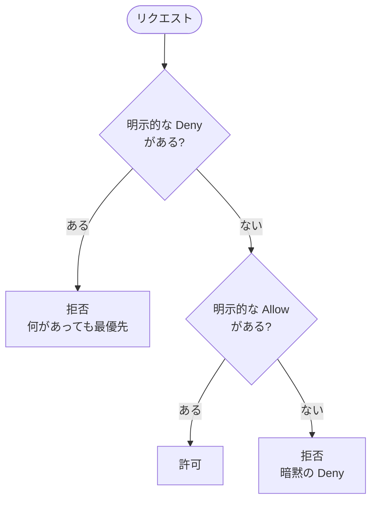

← [[SAA_01_AWSの基本(リージョン・AZ・責任共有モデル・Well-Architected)]] / 次 → [[SAA_03_ネットワーク(VPC・ELB・Route 53・CloudFront)]]

出題分野「セキュアなアーキテクチャの設計」は **30%** で最大。ここは確実に取る。

## IAM の登場人物
| 名前 | 何者か | ポイント |
| --- | --- | --- |
| **ルートユーザー** | アカウント作成時のメールアドレス | 日常では使わない。MFA を付けて封印 |
| **IAM ユーザー** | 人(またはプログラム)に発行する ID | 長期の認証情報(パスワード・アクセスキー)を持つ |
| **IAM グループ** | ユーザーの集まり | 権限はグループに付けて管理する |
| **IAM ロール** | 「一時的に借りる」権限 | **EC2・Lambda に権限を与えるのは必ずロール** |
| **ポリシー** | 権限を書いた JSON | ユーザー・グループ・ロールに付ける |

### 試験の鉄則
- **アプリにアクセスキーを埋め込まない** → EC2 には **インスタンスプロファイル(IAM ロール)**、Lambda には **実行ロール**
- **別アカウントのリソースを使う** → 相手側にロールを作り、**STS の AssumeRole** で一時的な認証情報を借りる
- **最小権限の原則**:必要な操作・必要なリソースだけを許可する

### ポリシーの評価順
```
1. 明示的な Deny がある?  → あれば 拒否(何があっても最優先)
2. 明示的な Allow がある? → あれば 許可
3. どちらもない          → 拒否(暗黙の Deny)
```


```json
{
  "Effect": "Allow",
  "Action": ["s3:GetObject"],
  "Resource": "arn:aws:s3:::my-bucket/*",
  "Condition": { "IpAddress": { "aws:SourceIp": "203.0.113.0/24" } }
}
```

### ポリシーの種類
| 種類 | 付ける場所 | 例 |
| --- | --- | --- |
| **アイデンティティベース** | ユーザー・グループ・ロール | 「このロールは S3 を読める」 |
| **リソースベース** | S3 バケット・SQS・KMS キーなど | バケットポリシー「このアカウントからの読み取りを許可」 |
| **許可の境界(Permissions Boundary)** | ユーザー・ロール | 「付けられる権限の上限」。開発者に権限付与を任せるとき |
| **SCP(サービスコントロールポリシー)** | Organizations の OU・アカウント | 「このアカウントでは東京以外のリージョン禁止」 |

→ **SCP と許可の境界は「上限」を決めるだけで、権限を与えない**。実際に使うには別途 Allow が必要。

## 複数アカウントとシングルサインオン
| サービス | 用途 |
| --- | --- |
| **AWS Organizations** | 複数アカウントをまとめる。一括請求(ボリューム割引)、SCP |
| **AWS Control Tower** | ベストプラクティスに沿ったマルチアカウント環境(ランディングゾーン)を自動で作る |
| **IAM Identity Center**(旧 AWS SSO) | 社員が1回のログインで複数アカウントに入る。社内の AD と連携 |
| **AWS RAM(Resource Access Manager)** | サブネットや Transit Gateway を他アカウントと共有 |
| **Amazon Cognito** | **自分のアプリの利用者**のログイン。ユーザープール(認証)とIDプール(AWS の一時認証情報を渡す) |
| **AWS Directory Service** | AWS 上の Microsoft AD。オンプレ AD と連携(AD Connector) |

→ 「社員が AWS 管理画面に入る」= Identity Center、「アプリの利用者がログインする」= Cognito。

## 暗号化
### 保管時の暗号化(at rest)
| 方式 | 鍵を管理するのは | 試験での使いどころ |
| --- | --- | --- |
| **SSE-S3** | AWS(S3 が全部やる) | 一番手軽。S3 は今はデフォルトでこれ |
| **SSE-KMS** | KMS(鍵の利用が CloudTrail に記録される) | 「鍵の使用を監査したい」「鍵のローテーション」 |
| **SSE-C** | お客様が毎回鍵を渡す | 「鍵を AWS に保存したくない」 |
| **クライアント側暗号化** | お客様(送る前に暗号化) | 「AWS に平文を一切渡さない」 |

| サービス | 特徴 |
| --- | --- |
| **AWS KMS** | マネージドな鍵管理。共有型の HSM。ほぼ全サービスと連携 |
| **AWS CloudHSM** | **専有(シングルテナント)の HSM**。「FIPS 140-2 レベル3」「鍵を完全に自社管理」 |

### 通信時の暗号化(in transit)
- **ACM(Certificate Manager)**:SSL/TLS 証明書を無料で発行・自動更新。ELB・CloudFront・API Gateway に付ける
- S3 で HTTPS を強制 → バケットポリシーで `aws:SecureTransport = false` を Deny

### 秘密情報の保存
| サービス | 違い |
| --- | --- |
| **Secrets Manager** | **自動ローテーション**ができる(RDS のパスワードなど)。有料 |
| **Systems Manager Parameter Store** | 設定値・秘密情報の保存。標準は無料。ローテーション機能はない |

→ 「DB パスワードを定期的に自動で変えたい」= Secrets Manager。

## 攻撃から守る・脅威を見つける
| サービス | 何をするか | キーワード |
| --- | --- | --- |
| **AWS WAF** | L7 のファイアウォール。ALB・CloudFront・API Gateway に付ける | SQL インジェクション、XSS、特定 IP・国のブロック、**レートベースルール** |
| **AWS Shield Standard** | DDoS 対策(L3/L4)。全員無料で自動適用 | — |
| **AWS Shield Advanced** | 高度な DDoS 対策、DDoS 対応チーム、DDoS による料金増の補償 | 「大規模な DDoS」 |
| **Amazon GuardDuty** | ログ(CloudTrail・VPC フローログ・DNS)を機械学習で分析し脅威を検知 | 「不審な通信」「乗っ取りの検知」 |
| **Amazon Inspector** | EC2・コンテナイメージ・Lambda の**脆弱性スキャン** | 「CVE」「ソフトウェアの脆弱性」 |
| **Amazon Macie** | S3 内の**個人情報(PII)を検出** | 「S3 の機密データを発見」 |
| **AWS Security Hub** | 上のサービスの結果を1か所に集約 | 「セキュリティ状態を一元管理」 |
| **Amazon Detective** | セキュリティ事象の原因を調査 | 「根本原因の調査」 |
| **AWS Firewall Manager** | 複数アカウントの WAF・SG ルールを一括管理 | 「組織全体に WAF ルールを適用」 |
| **AWS Network Firewall** | VPC 単位のステートフルなネットワークファイアウォール | 「VPC の出入り口でパケット検査」 |

## よく出るひっかけ
- **セキュリティグループで「特定 IP を拒否」はできない**(許可しか書けない)→ NACL か WAF
- **SCP はルートユーザーを含むメンバーアカウント全員に効く**(管理アカウントには効かない)
- KMS のキーは**リージョンごと**。別リージョンで復号したいならマルチリージョンキー
- S3 の暗号化をしたくても**既存オブジェクトは自動で暗号化されない**(S3 バッチオペレーションでコピーし直す)

## 確認ポイント
- [ ] EC2 からS3 を触らせる正しい方法(ロール)を言える
- [ ] 明示的 Deny > Allow > 暗黙の Deny を説明できる
- [ ] SCP・許可の境界は「上限」であって権限を与えないと言える
- [ ] KMS と CloudHSM、Secrets Manager と Parameter Store の違いを言える
- [ ] WAF・Shield・GuardDuty・Inspector・Macie を1行で説明できる

## 関連ノート
- [[認証]]
- [[APIキー・シークレット管理]]
- [[Webセキュリティ対策]] ― SQLi・XSS(WAF が防ぐもの)
- [[HTTP・HTTPS・TLS]] ― ACM の証明書が使われる場面
