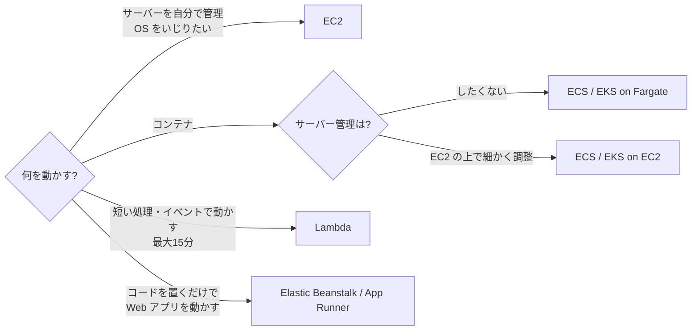
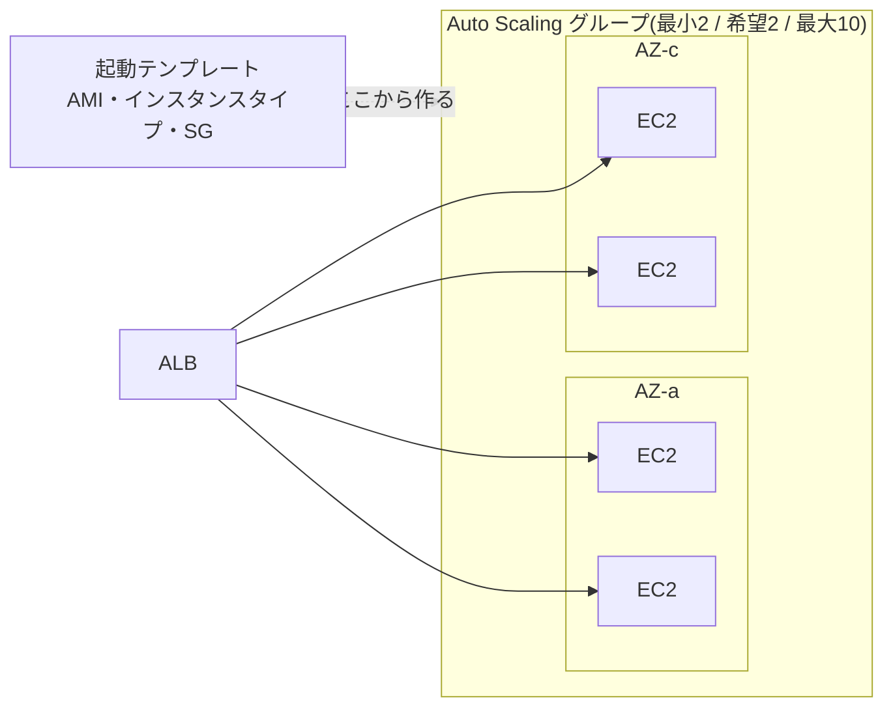
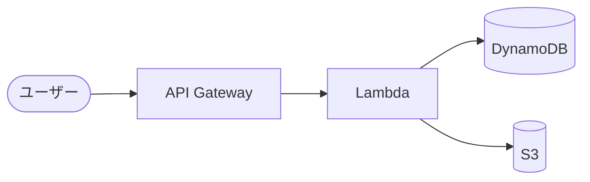

← [[SAA_03_ネットワーク(VPC・ELB・Route 53・CloudFront)]] / 次 → [[SAA_05_ストレージ(S3・EBS・EFS・FSx)]]

## 選び方の全体像
```
サーバーを自分で管理したい / OS をいじりたい ─────▶ EC2
コンテナで動かしたい
   ├─ サーバー管理もしたくない ──────────────────▶ ECS / EKS on Fargate
   └─ EC2 の上で細かく調整したい ───────────────▶ ECS / EKS on EC2
短い処理・イベントで動かす(最大15分)───────────▶ Lambda
コードを置くだけで Web アプリを動かしたい ───────▶ Elastic Beanstalk / App Runner
```



## EC2
### インスタンスタイプ
| ファミリー | 得意 | 例 |
| --- | --- | --- |
| **M / T** | 汎用(T はバースト型。普段は低負荷で時々高負荷) | Web サーバー |
| **C** | CPU | バッチ処理、動画エンコード |
| **R / X** | メモリ | インメモリ DB、大規模キャッシュ |
| **I / D** | ストレージ I/O | NoSQL、データウェアハウス |
| **P / G / Inf / Trn** | GPU・機械学習 | 学習・推論 |

### 購入オプション(コスト最適化の最頻出)
| オプション | 割引 | 向いている用途 |
| --- | --- | --- |
| **オンデマンド** | なし | 短期・予測できない負荷・お試し |
| **Savings Plans** | 最大 72% | 1年/3年の**利用額(1時間あたり $)を約束**。インスタンスタイプやリージョンを変えても効く(Compute SP は Lambda・Fargate にも) |
| **リザーブドインスタンス(RI)** | 最大 72% | 1年/3年、**決まったインスタンスを常時**動かす(DB など) |
| **スポットインスタンス** | **最大 90%** | 余っている容量を安く借りる。**2分前通知で中断される** → 中断されてもよい処理(バッチ、CI、ステートレスな Web) |
| **Dedicated Hosts** | — | 物理サーバーを丸ごと。**ソフトウェアのライセンス(ソケット・コア単位)を持ち込む** |
| **Dedicated Instances** | — | 他のお客様とハードを共有しない |
| **オンデマンドキャパシティ予約** | なし | 特定 AZ で容量を確保(割引なし。Savings Plans と組み合わせる) |

→ 「24時間365日動く本番」= Savings Plans / RI、「中断されても再実行できるバッチ」= スポット、「来月だけ増える」= オンデマンド。

### プレイスメントグループ
| 種類 | 配置 | 用途 |
| --- | --- | --- |
| **クラスター** | 1つの AZ に**ぎゅっと**まとめる | HPC、低遅延・高スループット通信 |
| **分散(Spread)** | 別々のハードに**バラバラ**に(AZ あたり最大7台) | 少数の重要なサーバーを同時故障から守る |
| **パーティション** | グループ単位でラックを分ける | Hadoop、Cassandra、Kafka |

### その他よく出る機能
- **AMI**:サーバーのイメージ。**別リージョンにコピー**して DR に使う
- **ユーザーデータ**:起動時に1回だけ動くスクリプト
- **インスタンスストア**:サーバーに直結の高速ディスク。**停止すると消える**(一時データ・キャッシュ用)
- **休止(Hibernate)**:メモリの内容を EBS に保存して停止 → 起動が速い
- **インスタンスメタデータ**:`169.254.169.254` から自分の情報を取得(IMDSv2 を使う)
- **CloudWatch で標準ではメモリ使用率が取れない** → **CloudWatch エージェント**を入れる

## Auto Scaling
```
[ALB] ─▶ [Auto Scaling グループ  最小2 / 希望2 / 最大10]
            ├─ AZ-a: EC2 EC2
            └─ AZ-c: EC2 EC2 (負荷が上がると増える)
         起動テンプレート(AMI・インスタンスタイプ・SG)から作る
```


| スケーリングポリシー | 動き | 使いどころ |
| --- | --- | --- |
| **ターゲット追跡** | 「CPU 50% を保つ」ように自動調整 | **まずこれ**。一番シンプル |
| **ステップ** | 「70% 超えたら +2、90% 超えたら +4」 | 細かく制御したい |
| **スケジュール** | 「毎週月曜 9 時に 10 台」 | **時間が決まっている負荷** |
| **予測(Predictive)** | 過去の傾向から先回りで増やす | 「毎日決まったパターン」 |

- **ELB ヘルスチェック**を使うと、アプリが落ちたインスタンスも入れ替える(EC2 ヘルスチェックはハードの故障だけ)
- **最小台数を2以上・複数 AZ**にして高可用性
- 起動に時間がかかる → **ウォームプール**、AMI に事前に入れておく(ゴールデン AMI)
- **ライフサイクルフック**:終了前にログを退避する

## Lambda(サーバーレス)
| 項目 | 値・特徴 |
| --- | --- |
| 最大実行時間 | **15分**(超えるなら ECS/Fargate・Batch・Step Functions) |
| メモリ | 128MB〜10GB(CPU はメモリに比例) |
| 一時領域 `/tmp` | 最大 10GB |
| 課金 | リクエスト数 + 実行時間(ms 単位) |
| 起動のきっかけ | API Gateway、S3 イベント、SQS、EventBridge、DynamoDB Streams など |

- **コールドスタート**を避けたい → **プロビジョニング済み同時実行**
- **VPC 内の RDS に大量の Lambda から接続** → 接続数があふれる → **RDS Proxy**
- 重いライブラリは**レイヤー**かコンテナイメージで

### サーバーレスのよくある組み合わせ
```
ユーザー ─▶ API Gateway ─▶ Lambda ─▶ DynamoDB
                                └──▶ S3
```


- **API Gateway**:REST / HTTP / WebSocket API。スロットリング、キャッシュ、API キー、Cognito 認証
- **Step Functions**:複数の Lambda を順番・分岐・リトライ付きで動かすワークフロー

## コンテナ
| サービス | 一言 |
| --- | --- |
| **ECS** | AWS 独自のコンテナ管理。シンプル |
| **EKS** | Kubernetes。「既に Kubernetes を使っている」「オープンソースで移植性」 |
| **Fargate** | ECS/EKS の**サーバーを管理しなくていい**実行環境 |
| **ECR** | コンテナイメージの置き場 |
| **App Runner** | コンテナやコードを置くだけで Web アプリが動く |

→ 「コンテナを使いたいが、サーバー(EC2)の管理はしたくない」= **ECS on Fargate**。

## その他
| サービス | 用途 |
| --- | --- |
| **Elastic Beanstalk** | コードをアップロードするだけで EC2・ELB・Auto Scaling を自動で組んでくれる |
| **AWS Batch** | 大量のバッチジョブを実行(スポットと相性がよい) |
| **Outposts** | AWS のラックを自社データセンターに置く |
| **Lightsail** | 定額の簡単な VPS |

## 確認ポイント
- [ ] オンデマンド・Savings Plans・RI・スポットを使い分けられる
- [ ] スポットの中断(2分前通知)を前提にした使い方を言える
- [ ] プレイスメントグループ3種を区別できる
- [ ] Auto Scaling のターゲット追跡とスケジュールの使い分けを言える
- [ ] Lambda の15分制限と RDS Proxy を覚えている
- [ ] 「サーバー管理なしでコンテナ」= Fargate と即答できる

## 関連ノート
- [[Cicdパイプライン]]
- [[Docker]] ― コンテナイメージの作り方(Dockerfile・Compose・ECS へのデプロイ)
