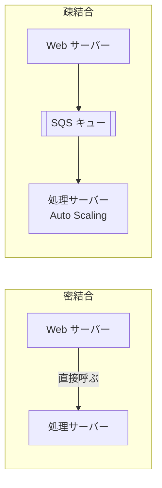
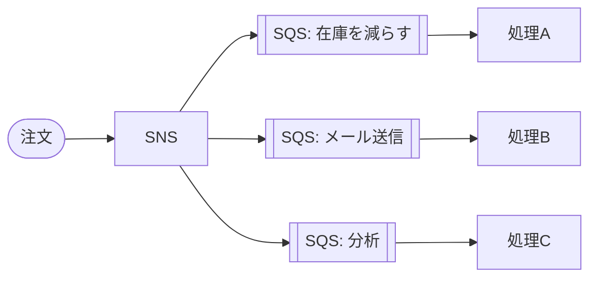

← [[SAA_06_データベース(RDS・Aurora・DynamoDB・ElastiCache)]] / 次 → [[SAA_08_高可用性・DR・移行(バックアップ・DR戦略・監視)]]

## 疎結合とは
```
【密結合】 Web サーバー ──直接呼ぶ──▶ 処理サーバー
           処理が詰まる・落ちると、Web サーバーもエラーになる

【疎結合】 Web サーバー ──▶ [SQS キュー] ──▶ 処理サーバー(Auto Scaling)
           Web は投げるだけ。処理側が落ちてもメッセージはキューに残る
```


→ 「急なアクセス増でも注文を失わない」「処理を非同期にしたい」= **間に SQS を挟む**。

## SQS(キュー)
| | **標準キュー** | **FIFO キュー** |
| --- | --- | --- |
| 順序 | だいたいの順番(保証なし) | **順番を保証** |
| 重複 | まれに2回届く(少なくとも1回) | **1回だけ処理**(重複排除) |
| スループット | ほぼ無制限 | 制限あり(高スループットモードで引き上げ可) |
| 名前 | 自由 | 末尾が `.fifo` |

→ 「注文の順番どおりに処理」「二重処理を防ぐ」= FIFO。

| 用語 | 意味 |
| --- | --- |
| **可視性タイムアウト** | 受け取ったメッセージを他の人から隠す時間(デフォルト30秒)。処理時間より長くする。短いと**二重処理**の原因 |
| **保持期間** | デフォルト4日、最大14日 |
| **ロングポーリング** | メッセージが来るまで最大20秒待つ → 空振りの API 呼び出しが減りコスト削減 |
| **デッドレターキュー(DLQ)** | 何度処理しても失敗するメッセージを退避 |
| **遅延キュー** | 届いてから一定時間見えなくする |

- **キューの長さ(ApproximateNumberOfMessages)で Auto Scaling** する構成がよく出る

## SNS(通知・ファンアウト)
- **1つのメッセージを多数の宛先に配る**(Pub/Sub)。宛先:SQS、Lambda、HTTP、メール、SMS
- **ファンアウト**:SNS → 複数の SQS に同時に配り、それぞれ別の処理をする
```
            ┌─▶ SQS(在庫を減らす) ─▶ 処理A
注文 ─▶ SNS ─┼─▶ SQS(メール送信)   ─▶ 処理B
            └─▶ SQS(分析)         ─▶ 処理C
```


- **メッセージフィルタリング**:宛先ごとに受け取る条件を変える

## EventBridge(イベントバス)
- 「何かが起きたら、ルールに一致したものを宛先に送る」
- AWS サービスのイベント(EC2 が停止した、など)、SaaS のイベント、自作アプリのイベントを扱える
- **スケジュール**(cron)で Lambda を定期実行 → 「毎晩 2 時にバッチ」
- 迷ったら:**AWS のイベントやスケジュールで何かを起動 = EventBridge**、**単純な一斉通知 = SNS**、**溜めて順番に処理 = SQS**

## ストリーミング(Kinesis)
| サービス | 特徴 | キーワード |
| --- | --- | --- |
| **Kinesis Data Streams** | **リアルタイム**で大量データを受け取り、複数の処理で読む。保持 24時間〜365日、再読み込み可 | 「リアルタイム分析」「クリックストリーム」「IoT」 |
| **Amazon Data Firehose**(旧 Kinesis Data Firehose) | 受け取ったデータを **S3・Redshift・OpenSearch に自動で届ける**。ほぼリアルタイム(数十秒〜)、サーバーレス、変換も可 | 「S3 に保存したい」「管理不要」 |
| **Managed Service for Apache Flink** | ストリームを SQL や Flink で分析 | 「ストリームをリアルタイムで集計」 |
| **Amazon MSK** | マネージドな Apache Kafka | 「既に Kafka を使っている」 |

→ 「リアルタイムに自前の処理」= Data Streams、「とにかく S3 に貯めたい」= Firehose。

## 分析
| サービス | 一言 | キーワード |
| --- | --- | --- |
| **Athena** | **S3 のファイルに直接 SQL**。サーバーレス、スキャン量で課金 | 「S3 のログをアドホックに分析」 |
| **Redshift** | データウェアハウス。大量データの集計(列指向) | 「BI」「ペタバイト規模の分析」 |
| **Redshift Spectrum** | Redshift から S3 のデータも検索 | — |
| **Glue** | サーバーレス ETL、**データカタログ**(テーブル定義を管理)、クローラー | 「データを変換して分析しやすく」 |
| **EMR** | Hadoop・Spark のクラスター | 「Spark」「ビッグデータ処理」 |
| **Lake Formation** | データレイクの構築と、細かい権限管理 | 「データレイクの列単位の権限」 |
| **QuickSight** | BI ダッシュボード | 「可視化」 |
| **OpenSearch Service** | 全文検索・ログ分析 | 「全文検索」 |

- Athena のコストを下げる → **Parquet などの列指向形式**に変換、**パーティション分割**、圧縮

## その他の連携サービス
| サービス | 用途 |
| --- | --- |
| **Step Functions** | 複数の処理をワークフローとしてつなぐ(順番・分岐・待機・リトライ) |
| **Amazon MQ** | ActiveMQ / RabbitMQ。**既存のアプリが MQTT・AMQP などのプロトコルを使う**ときの移行先 |
| **AppSync** | GraphQL API |
| **SES** | メール送信 |

→ 「オンプレの RabbitMQ をコードを変えずに移したい」= Amazon MQ(SQS だとアプリ改修が必要)。

## 確認ポイント
- [ ] SQS を挟むと何がうれしいか説明できる
- [ ] 標準キューと FIFO の違い、可視性タイムアウトを説明できる
- [ ] SNS ファンアウトを図に描ける
- [ ] SQS・SNS・EventBridge の使い分けを言える
- [ ] Kinesis Data Streams と Firehose の違いを言える
- [ ] Athena・Redshift・Glue を1行で説明できる

## 関連ノート
- [[GraphQL]] ― AppSync
